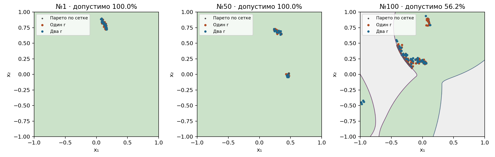
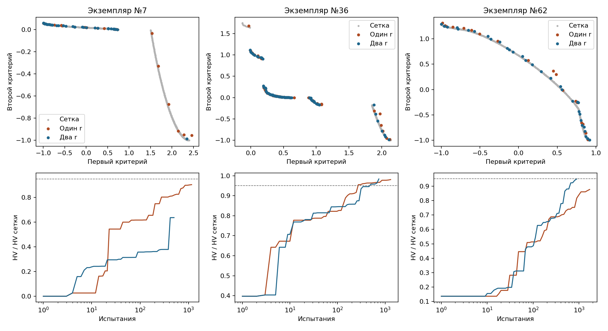

# Ограниченные многокритериальные задачи GKLS

Модуль `gklsC_mco` реализует двумерную серию из 100 задач на квадрате
$[-1,1]^2$. Для экземпляра с номером `k` берутся четыре последовательные
функции GKLS с переходом от №100 к №1. Первые две задают критерии, остальные
две — ограничения. В интерфейсе Globalizer номера функций идут в порядке
`g1, g2, f1, f2`. Параметр задачи `problemIndex` принимает значения от 1 до 100.

Параметры GKLS соответствуют типу TD, расстоянию 0,9, радиусу 0,2, десяти
минимумам и значению глобального минимума −1. Масштаб каждого ограничения
рассчитывается по исходному положению его минимума и минимуму второго
критерия. Затем минимум ограничения перегенерируется в точке минимума
первого критерия. Для общей доли 0,5 порог определяется по гистограмме
максимума ограничений на сетке 201×201. Исходный алгоритм повышает порог,
если он ниже значения максимума ограничений в точке минимума второго
критерия. Фактическая доля допустимой области поэтому зависит от экземпляра.
[Исходный модуль Лебедева, cbf4284](https://github.com/LebedevIlyaG/globalizer/tree/cbf4284/problems/gklsC_mco)

## Сборка и запуск

Из корня Globalizer в PowerShell с инициализированными подмодулями, включая
GCGen, и с каталогом `Problems/gklsC_mco` в Globalizer_Benchmarks:

```powershell
$build = Join-Path $PWD build_gkls_mco
$bin = Join-Path $build _bin
cmake -S . -B $build -G "Visual Studio 17 2022" -DGLOBALIZER_USE_MPI=OFF -DGLOBALIZER_USE_MP=OFF -DGLOBALIZER_BUILD_PROBLEMS=ON -DGLOBALIZER_BUILD_TESTS=ON -DgklsC_mco_build=ON "-DGLOBALIZER_OUTPUT_DIRECTORY=$bin" "-DGLOBALIZER_BENCHMARKS_OUTPUT_DIRECTORY=$bin"
cmake --build $build --config Release --target gklsC_mco GlobalizerGKLSMCOMain GLOBALIZER_tests
ctest --test-dir $build -C Release --output-on-failure
& "$bin/GlobalizerGKLSMCOMain.exe" "$bin/gklsC_mco.dll" 1 "$build/trials.csv" solve 1000 1.5
```

При отдельной сборке Globalizer_Benchmarks передайте путь к исходникам GCGen через
`-DGKLS_MCO_GCGEN_DIR=...`. Модуль собирается из тех же исходников GCGen.
Для Linux пример принимает путь к `libgklsC_mco.so`.

## Эксперимент

Для обработки результатов нужны Python 3, NumPy и Matplotlib. Укажите новый
каталог для результатов. Каждый параллельный процесс решает свой экземпляр,
для каждого решения используется один поток.

```powershell
$out = Join-Path $build results
python experiments/gkls_mco.py "$bin/GlobalizerGKLSMCOMain.exe" "$bin/gklsC_mco.dll" $out --jobs 3
python experiments/gkls_mco_report.py $out
```

Для короткой проверки добавьте к первой команде `--instances 1 50 100`.
Во всех парах используются 50 весов от (0,1) до (1,0), глобальный r=5,6,
ε=0,02, плотность развёртки m=12, масштабирование критериев отключено.
Локальный r равен 0 или 1,5. Для каждого лимита (1 000, 3 000, 10 000)
выполняется новый запуск. Остановка по точности допускает меньшее число
испытаний. В CSV испытаний пустая пара критериев означает недопустимую точку.

Эталон — недоминируемые допустимые точки сетки 1001×1001. Его HV
сравнивается с результатом сетки 501×501. Если изменение HV достигает
наименьшей абсолютной парной разницы HV по трём лимитам (с точностью 1e−10),
строится сетка 2001×2001. Критерии нормируются вычитанием −1 и делением на
разность между максимумом соответствующей координаты фронта сетки 1001×1001
и −1. Масштаб одинаков для всех запусков одного экземпляра. Опорная точка HV
после нормировки — (1,1; 1,1). Отношение HV к сеточному эталону может
превышать единицу, поскольку решатель посещает и точки между узлами.
IGD+ усредняет расстояние от каждой точки сеточного фронта до ближайшей
найденной с учётом только ухудшений координат.

- `metrics.csv` содержит затраты и качество для каждого запуска. Счётчики
  функций учитывают только работу решателя, включая отброшенные испытания.
  Пустое `trials_to_95` означает, что запуск завершился до достижения 95% HV эталона.
- `pairs.csv` содержит разности «два r минус один r». В `delta_common_hv`
  архивы сравниваются на меньшей из двух фактических длин поиска.
- `summary.csv` содержит медиану, квартили и число пар каждого знака.
- `fronts.png` показывает примеры с минимальной, медианной и максимальной
  парной разницей HV при наибольшем лимите, а также ход поиска. В `domains.png`
  показаны допустимые области и точки Парето в пространстве переменных для
  контрольных экземпляров №1, 50 и 100.

## Результаты для серии из 100 экземпляров

На карте зелёным показаны допустимые узлы, точками — найденные решения Парето.
На экземплярах №1 и №50 оба ограничения выполнены на всей проверочной сетке,
на №100 допустимы 56,2% узлов.



| Лимит испытаний | Медиана испытаний, один / два r | Медиана HV относительно сеточного эталона, один / два r | Больший итоговый HV с двумя r |
|---:|---:|---:|---:|
| 1 000 | 905 / 632 | 91,0% / 94,5% | 76 из 100 |
| 3 000 | 1 721 / 716 | 94,9% / 95,6% | 66 из 100 |
| 10 000 | 1 919 / 743,5 | 95,9% / 96,1% | 58 из 100 |

При лимите 10 000 режим с двумя r завершился раньше на всех экземплярах.
При сравнении после одинакового фактического числа испытаний в каждой паре
он дал больший HV на 85 экземплярах. На рисунке показаны три примера при
этом лимите. На №7 виден участок фронта, который лучше покрыл метод с одним r.
Пунктир на нижних графиках обозначает 95% HV сеточного эталона.


